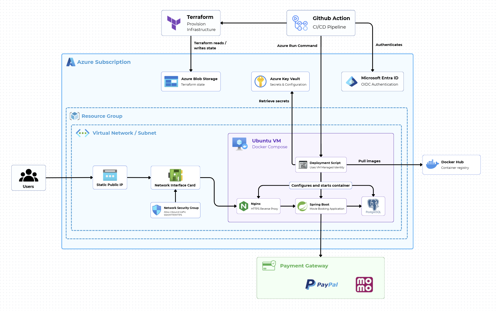

# Movie Booking Platform

A production-oriented movie ticket booking backend built with Spring Boot and Java 21. The platform models the complete booking lifecycle: movie and cinema management, showtimes, seat selection, temporary seat reservations, dynamic pricing, promotions, membership benefits, QR tickets, refunds, and payment initiation through MoMo and PayPal.

The project also includes automated testing, k6 performance scenarios, containerized deployment, Terraform infrastructure for Azure, and GitHub Actions pipelines for CI/CD.

## Architecture



The deployed system runs on an Azure VM behind Nginx. GitHub Actions authenticates to Azure with OIDC, Terraform provisions the network, VM, managed identity, and Key Vault, and the deployment workflow uses Azure Run Command to pull the backend image and restart Docker Compose. Runtime secrets are retrieved from Azure Key Vault through the VM managed identity.

## Why this project is technically interesting

- **Concurrency control:** Redis-backed, time-limited seat locks prevent two users from booking the same seat during checkout. The API supports both authenticated users and guest sessions through `X-Session-Id`.
- **Atomic checkout:** booking confirmation and payment initiation are coordinated in a transaction. If payment initiation fails, the pending booking is rolled back.
- **Payment integrations:** MoMo and PayPal flows include redirect/callback handling, payment status tracking, refunds, and currency conversion for PayPal.
- **Business rules:** ticket types, seat types, time-based modifiers, special-event pricing, promotions, and membership tiers are composed into the final price.
- **Security:** JWT authentication, refresh tokens, role-based access, OAuth2 client support, and secure cookie/session handling.
- **Observability:** Spring Boot Actuator and Micrometer expose application and JVM metrics for Prometheus and Grafana, with PostgreSQL and host metrics available to the monitoring stack.
- **Delivery automation:** GitHub Actions runs change-aware smoke and sanity tests, supports full regression runs, builds and publishes the Docker image, and deploys to Azure.

## Technology stack

| Area | Technologies |
| --- | --- |
| Backend | Java 21, Spring Boot 3.5.6, Spring MVC, Spring Data JPA, Spring Security |
| Data | PostgreSQL 17, Redis 7, Testcontainers |
| API | REST, JWT, OAuth2 client, OpenAPI/Swagger |
| Payments | MoMo, PayPal Checkout SDK |
| Delivery | Docker, Docker Compose, Nginx, Docker Hub |
| Cloud and IaC | Microsoft Azure, Terraform, Azure Key Vault, managed identity, OIDC |
| Quality and observability | JUnit 5, RestAssured, smoke/sanity/regression tags, k6, Prometheus, Grafana |

## Core booking flow

1. A user or guest session selects seats for a showtime.
2. The API acquires a Redis-backed seat lock with an expiry time and stores the calculated ticket prices.
3. Checkout validates ownership and expiry of the lock, applies snacks, promotions, and membership benefits, then creates a pending booking.
4. The selected payment gateway is initialized. Failed initiation rolls the transaction back.
5. The gateway callback updates payment and booking state, and a QR ticket is generated for successful bookings.

Detailed request and response examples are available in the [API documentation](backend/docs/README.md), including the [booking flow](backend/docs/API-Bookings.md) and [atomic checkout](backend/docs/API-Checkout.md).

## Run locally with Docker Compose

### Prerequisites

- Docker Desktop with Docker Compose
- A running Redis 7 instance reachable by the backend
- A Docker Hub image name in `DOCKERHUB_USERNAME`, unless you replace the backend image with a locally built image
- Test or sandbox credentials for MoMo and PayPal when exercising payments

Create `backend/.env` from the following template. Keep real credentials out of Git:

```env
POSTGRES_DB=moviebooking
POSTGRES_USER=postgres
POSTGRES_PASSWORD=your_password
DATA_SOURCE_URL=jdbc:postgresql://db:5432/moviebooking

REDIS_HOST=redis
REDIS_PORT=6379

JWT_SECRET=replace-with-a-secret-of-at-least-256-bits
JWT_EXPIRATION=3600000
JWT_REFRESH_EXPIRATION=86400000

MOMO_PARTNER_CODE=your_partner_code
MOMO_ACCESS_KEY=your_access_key
MOMO_SECRET_KEY=your_secret_key
MOMO_ENDPOINT=https://test-payment.momo.vn/v2/gateway/api/create
MOMO_REDIRECT_URL=http://localhost:5173/payment/callback
MOMO_IPN_URL=http://localhost:8080/api/payments/momo/ipn

PAYPAL_CLIENT_ID=your_paypal_client_id
PAYPAL_CLIENT_SECRET=your_paypal_client_secret
PAYPAL_MODE=sandbox
PAYPAL_RETURN_URL=http://localhost:5173/payment/callback
PAYPAL_CANCEL_URL=http://localhost:5173/payment/cancelled

DATA_SOURCE_NAME=postgresql://postgres:your_password@db:5432/moviebooking?sslmode=disable
```

Start the services defined by the repository Compose file:

```bash
docker compose up -d
docker compose logs -f moviebooking
```

The root Compose file does not declare a Redis container. For local Maven development, start one separately:

```bash
docker run --name moviebooking-redis -p 6379:6379 -d redis:7-alpine
```

For a containerized backend, place Redis on the same Docker network and set `REDIS_HOST` to its container name. The checked-in Compose file currently starts PostgreSQL, the backend image, and Nginx.

Stop the stack with `docker compose down`. Use `docker compose down -v` only when you intentionally want to remove the PostgreSQL volume and local data.

### Local endpoints

| Service | URL |
| --- | --- |
| Backend API | `http://localhost:8080/api` |
| Swagger UI | `http://localhost:8080/swagger-ui/index.html` |
| Actuator health | `http://localhost:8080/actuator/health` |
| Nginx HTTP | `http://localhost` |
| PostgreSQL | `localhost:5433` |

The Compose file exposes Nginx on ports 80, 443, and 8888. Prometheus and Grafana are part of the observability design and CI/load-test configuration; they are not declared as services in the root Compose file.

## Build and run the backend locally

```bash
cd backend

# Run the default test suite
./mvnw test

# Run the tagged suites explicitly
./mvnw test -Psmoke
./mvnw test -Psanity
./mvnw test -Pregression

# Package the application
./mvnw clean package

# Run the application; PostgreSQL and Redis must be reachable
./mvnw spring-boot:run
```

On Windows, use `mvnw.cmd` in place of `./mvnw`.

## Testing and performance validation

The test suite combines unit tests, Spring integration tests, Testcontainers-backed PostgreSQL/Redis tests, MockMvc/RestAssured API tests, and JUnit-tagged smoke, sanity, and regression suites.

k6 scenarios live in [`k6-tests/scenarios`](k6-tests/scenarios). With k6 installed locally, run a scenario with:

```bash
k6 run k6-tests/scenarios/01-seat-lock-concurrency.js
```

Available scenarios cover browsing load, the end-to-end booking workflow, concurrent seat reservation, traffic spikes, and soak testing. Existing result notes are stored beside the scenarios in [`k6-tests/scenarios/results`](k6-tests/scenarios/results).

## CI/CD and infrastructure

- [`ci.yml`](.github/workflows/ci.yml) detects affected modules, runs smoke tests, selects relevant sanity tests, optionally runs full regression, and publishes the backend image to Docker Hub on pushes to `main`.
- [`cd.yml`](.github/workflows/cd.yml) authenticates to Azure with OIDC and deploys the selected image to an Azure VM through Azure Run Command.
- [`iac-infra.yml`](.github/workflows/iac-infra.yml) runs Terraform plan/apply/destroy workflows and synchronizes infrastructure outputs with GitHub Actions secrets.
- [`infrastructure/terraform`](infrastructure/terraform) provisions the Azure resource group, virtual network/subnet, public IP, network security group, VM, managed identity, and Key Vault.
- Nginx terminates public HTTPS traffic and reverse-proxies requests to the backend container.

Production deployment requires GitHub Actions secrets and Azure Key Vault values for database, JWT, payment, Docker Hub, domain, and certificate configuration. Do not commit `.env` files, tokens, private keys, or Terraform state.

## API documentation

The backend documentation includes:

- [Authentication](backend/docs/API-Authentication.md)
- [Bookings and seat locks](backend/docs/API-Bookings.md)
- [Atomic checkout](backend/docs/API-Checkout.md)
- [Movies](backend/docs/API-Movies.md)
- [Showtimes](backend/docs/API-Showtimes.md)
- [Payments and refunds](backend/docs/API-Payments.md)
- [Pricing and promotions](backend/docs/API-Pricing.md)
- [Cinemas, seats, users, and membership tiers](backend/docs/README.md)

## Repository structure

```text
.
├── backend/                 # Spring Boot API, tests, and API documentation
├── infrastructure/         # Terraform modules and dev environment
├── k6-tests/                # Performance scenarios and result notes
├── nginx/                   # Reverse proxy and HTTPS configuration
├── .github/workflows/       # CI, CD, and Terraform workflows
├── architecture.png        # Deployment architecture diagram
└── docker-compose.yml       # Database, backend, and Nginx orchestration
```

## Project positioning

This repository demonstrates backend engineering and delivery ownership across API design, transactional workflows, distributed locking, payment integration, automated testing, observability, infrastructure as code, and Azure deployment. For a CV, describe your specific contribution and include measurable evidence such as test coverage, load-test throughput/latency, deployment frequency, or booking contention results where available.

## License

SE113 project — University assignment.
